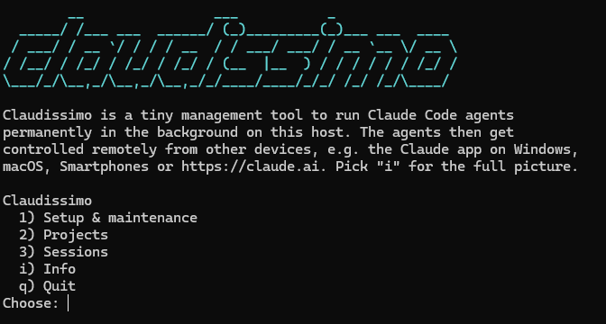

# claudissimo

This tiny tool helps you setup Claude Code background agents and manage
their projects on an Ubuntu/Debian machine to run permanently. You then
remote control them from any other device using the Claude app or website.
This way, you're able to work on code projects on the go while the agents
live on e.g. a VM somewhere and you do not have to leave your laptop on.
Set it up once, and sessions survive reboots on their own. On top of
live sessions, it can also run recurring one-off tasks on their own
schedule (e.g. a daily summary mailed to you) — independent of any
session being open or even alive.



## Usage

    bin/claudissimo

Shows a numbered menu grouped into three submenus — **Setup &
maintenance** (initial setup, status, update, monitoring), **Projects** (create,
delete), **Sessions** (revive, remove, start, scheduled tasks) — plus
Info, all in the same terminal, no curses UI. The first line under the
title always says until when your Claude login is valid. Status opens its own
further submenu so you can look at projects, background sessions, the
boot revive service, the periodic revive timer, memory, or versions on
their own instead of one long dump; scheduled tasks likewise has its
own add/list/edit/run/remove submenu.

Each action is also available directly as a subcommand — handy for
scripting, e.g. in a cron job:

    bin/claudissimo setup
    bin/claudissimo status [projects|agents|service|timer|memory|versions]
    bin/claudissimo update
    bin/claudissimo new
    bin/claudissimo delete   # still asks you to re-type the project name
    bin/claudissimo revive
    bin/claudissimo remove
    bin/claudissimo start
    bin/claudissimo task [add|list|edit|run|remove]
    bin/claudissimo auth [login|restart]
    bin/claudissimo check [--probe] [--push]   # for monitoring, see below
    bin/claudissimo info
    bin/claudissimo --version

Projects live under `~/claude-projects` by default; override with
`CLAUDE_PROJECTS_ROOT=/some/other/path bin/claudissimo ...`.

## Functions

This tool offers twelve actions through a one-line interactive menu — no
curses UI, output stays in your normal scrollback:

1. **Initial setup** — installs the pieces needed to run background sessions
   and survive a reboot: `jq`, `git`, `curl`, Claude Code itself if missing
   (via the official installer), a revive script, a systemd boot service,
   a second plain oneshot service that runs the same script (the boot
   service uses `RemainAfterExit=yes` so systemd doesn't clean up the
   daemon it starts — but that also makes a timer-triggered `systemctl
   start` on it a silent no-op once it's "active (exited)", confirmed the
   hard way, hence the separate service), and a **systemd timer that runs
   that second service every 15 minutes** (not just at boot — Claude
   Code's own supervisor can stop an idle or memory-pressured session
   mid-uptime; see
   [agent-view.md](https://code.claude.com/docs/en/agent-view.md)). Also
   enables linger so these units run without an active login, and turns on
   `remoteControlAtStartup` in `~/.claude/settings.json` so new sessions can
   be controlled remotely from the start. From the interactive menu, it
   explains itself and asks for confirmation before changing anything.
2. **Status** — reports, for every project directory and every
   background session: whether it's actually alive, whether it ended up
   in an unwanted git worktree, whether the revive service and the
   periodic revive timer are enabled (including the triggered service's
   last actual run time), and current memory usage (host total/free plus
   claude processes' RSS — low memory makes Claude Code's own supervisor
   stop idle sessions sooner). Also shows authentication — when the
   login runs out and what to do about it — and reports versions:
   claude's, jq/git/curl's (plus whether apt has a pending upgrade for
   them), whether the four deployed files still match this tool's
   current version, and whether this checkout itself is behind its git
   remote (if it has one) — everything `update` would act on, shown
   without changing anything.
3. **Update** — refreshes what this host needs to keep running: `claude
   update`, the `jq`/`git`/`curl` packages, this tool's own repo
   (`git pull --ff-only`, if it's a checkout with an upstream and no
   uncommitted changes), and the four deployed files (revive script, boot
   service, timer-triggered revive service, timer) if this tool's version
   of them has changed — including whatever the repo pull just brought in.
   Never overwrites a deployed file without asking first. Does **not**
   touch your *managed project* repos (trace, ngtrng, ...) — those stay plain
   `git pull`, by hand, per project.
4. **New project** — asks for a project name, then whether it should be a
   git project or purely local: git clones a remote if you give one (or
   just runs `git init`), local skips `.git` entirely. Sets
   `bgIsolation: none` so background sessions edit the project folder
   directly instead of a worktree copy. Runs `claude` interactively once
   for the first-run trust confirmation (that's on you), then starts the
   first background session, named after the project, with a fixed
   prompt that has it report its hostname, working directory, and git
   remote.
5. **Delete project** — completely removes a project: stops and removes
   any background session still pointing at it, deletes the project
   directory under `~/claude-projects`, and deletes its Claude Code
   metadata under `~/.claude/projects/` (session history, memory). Warns
   about uncommitted changes and commits not pushed to any upstream
   before you confirm — those would be lost; nothing else needs doing on
   the GitHub side, deleting a local clone doesn't touch the remote repo.
   Asks you to re-type the project name to confirm — this cannot be
   undone.
6. **Revive dead sessions** — runs the deployed revive script right now,
   instead of waiting for a reboot: for when a session died mid-uptime
   (a crash, say) rather than from the VM restarting. Same logic the
   systemd service uses at boot — checks every session's pid, and
   `claude respawn`s whichever ones aren't actually alive. It also
   checks every scheduled task's timer and kicks its service once if
   the timer has no computed next run — a reboot wipes
   `OnUnitActiveSec`'s reference point (it only lives in the current
   systemd user instance), so every scheduled task would otherwise sit
   idle after a reboot until manually restarted.
7. **Remove session** — lists sessions and lets you pick one to delete
   from Claude Code's own list (`claude rm`) — not just stop it. A
   merely stopped session is still listed and still gets picked up and
   respawned by the revive script/timer; this is the documented way to
   make one stay gone. `claude rm` deletes the conversation transcript
   from disk — not a soft delete, unrecoverable, verified. Project
   memory (`~/.claude/projects/.../memory/`) lives separately by path
   and survives, so a future session in that folder still has it, just
   not that conversation. Warns first if it's the only session pointed
   at its project folder, since removing it leaves that project with no
   background session at all.
8. **Start session** — starts a background session in a project
   directory that already exists but has no session left (the last one
   got removed or never came back). Unlike `new`, doesn't touch git,
   `settings.local.json`, or the trust prompt — the project already
   went through that once. Warns if the project already has a session
   and asks before starting another — with `bgIsolation: none`, a
   second session edits the exact same files directly, no worktree
   isolation; Claude Code's own docs don't protect against two
   sessions editing the same file concurrently.
9. **Scheduled tasks** — add, list, edit, run now, or remove a recurring
   one-shot task: a systemd timer running `claude -p` (non-interactive,
   prompt piped via stdin — no shell-quoting issues) on a fixed
   interval in a chosen project. Same proven pattern as the revive
   timer (plain oneshot service, no `RemainAfterExit`, so it can
   actually be re-triggered). Each run is a SHORT-LIVED session: no
   connection to any other chat, fresh context every time — it can
   read/write files, use git, and send mail (msmtp is configured) if
   asked to, but it cannot see or post into any currently running
   background session for that project. Edit changes the interval
   and/or prompt and rewrites the timer file — any interval works
   (hours only, no upper bound, e.g. 168 for weekly), but a one-off
   `OnCalendar=` schedule set by hand is not preserved across an edit.
   Run now starts a task's service immediately in the background
   (refuses if it's already running); that counts as a run, so the next
   scheduled one moves to now plus the interval.

10. **Authentication** — Found under Status > Authentication in the
    menu. The stored claude.ai login has a hard time limit of about four
    weeks that cannot be renewed, so the main menu always shows the date
    it is valid until and turns into a warning seven days before (and
    red once it ran out); the end of setup says so too. When it runs
    out, sessions keep running but are useless, scheduled tasks fail,
    and the Claude app shows the sessions as unreachable; a re-login
    alone does not reach processes that are already running (the revive
    script skips them, their pid is alive). The Authentication screen
    shows the state and what to do, and offers the two steps: Sign in
    again (`claude auth login`) and Restart sessions (stops the daemon
    and lets the revive script bring every session back with the current
    login — an answer being written is aborted, the conversations stay,
    and it refuses to run from inside a Claude session, so use a normal
    SSH terminal). Both are also available as `auth login` and `auth
    restart`. A 1-year token (`claude setup-token`) does not replace
    this: tried and dropped — while a stored login exists the daemon
    starts without it, and a session running on the token alone did not
    show up under Remote Control. Not verified: that signing in again
    shortly before the date resets the four weeks, and the whole
    sign-in-and-restart path with an already expired login.
11. **Check** — For your monitoring: one line, Nagios-style exit code (0
    OK, 1 WARNING, 2 CRITICAL) plus performance data, e.g. `claudissimo
    OK - 7 sessions alive, login valid for 27 days | sessions=7 …`.
    Critical: a session whose pid has no running claude process, the
    revive timer is not active, not logged in or the login expired, a
    scheduled task whose last run failed to authenticate, a failed probe
    request. Warning: the login expires within 7 days, a scheduled
    task's last run failed, a task timer lost its next run, no
    background sessions at all, or the session list could not be read.
    It does not notice a session that is alive but stuck for some other
    reason. A plain `check` makes no request. `--probe` sends one tiny
    real request — the only test that proves authentication works end to
    end; `--push` (what the timer runs) does that by itself at most once
    an hour, and again on every push while the last one failed. Runs
    fine over SSH from a non-login shell; `--push` additionally sends
    the result to the targets set up under Monitoring.
12. **Monitoring** — Pushes the result of `check` to Uptime Kuma (push
    monitor) and/or a webhook (JSON POST; any receiver works, e.g. Home
    Assistant) on a systemd timer, set up from the menu: Setup &
    maintenance > Monitoring. Push on purpose: if the host or the timer
    dies, the pushes stop and Uptime Kuma alarms by itself, which a pull
    over SSH can't do for a dead host. The URLs contain a secret, so
    they are kept in `~/.config/claudissimo/monitoring.conf` (readable
    by you only), never shown in full and never on a command line.
    Uptime Kuma: add a monitor of type Push, paste its Push URL, and set
    its heartbeat interval (Kuma counts in seconds) to twice the timer
    interval plus one minute (default timer: every 5 minutes, so 660
    seconds); OK counts as up, warning and critical as down. Webhook:
    the receiver gets a JSON with `code` (0/1/2), `status`, `message`
    and `perfdata`. Tested against a local mock server (requests,
    encoding, status mapping, failure handling); not against a real
    Uptime Kuma or Home Assistant.

    Example Home Assistant automation (untested here, adjust the notify service):
    
    ```yaml
    alias: claudissimo alert
    triggers:
      - trigger: webhook
        webhook_id: "<the id from the webhook URL>"
        allowed_methods: [POST]
        local_only: true
    conditions:
      - condition: template
        value_template: "{{ trigger.json.code | int > 0 }}"
    actions:
      - action: notify.notify
        data:
          title: "claudissimo {{ trigger.json.status }}"
          message: "{{ trigger.json.message }}"
    ```

## Troubleshooting

Background sessions should show up automatically in the Claude app (or
claude.ai) on any other device signed into the same account — no extra step
needed. If one doesn't show up:

- check it's actually running here first: `bin/claudissimo status` (a dead
  session can't show up anywhere)
- make sure this machine has internet access (setup needs it to register
  sessions with claude.ai)
- make sure you're signed into the same Claude account on both this machine
  and the other device
- a session started before `remoteControlAtStartup` was enabled may not
  have picked it up — try `claude respawn <id>` on it, or just create a new
  one (unverified, worth testing)
- if it's alive here but shows as unreachable in the app, restart the
  Claude app on the other device completely
- if the sessions are alive here but never answer (state `blocked`, even
  after a re-login): their credentials probably ran out —
  the first line of the main menu says so; fix it under
  Status > Authentication (sign in again, then restart sessions)

## Why `pid`, not `pgrep`

A dead background session can still show state `done` after a reboot, and
`claude respawn` hands a session to a pre-started spare process whose command
line doesn't contain the session id — so matching by name with `pgrep` gives
false positives. The only reliable check is reading the `pid` from
`claude agents --json --all` and confirming `/proc/<pid>/cmdline` still
belongs to a `claude` process. Both the revive script and the status action
use this check.

## Why not Docker

The actual mechanism this tool relies on is systemd user services plus
`loginctl` linger — that's what survives a reboot with no login needed,
and timers are what give scheduled tasks their persistence too. Neither
maps cleanly onto a container: a containerized systemd needs privileges
most hosts don't want to grant, and project directories would need full
bind-mounts back onto the host anyway, which defeats the isolation a
container is supposed to buy in the first place. A plain `git clone` of
this repo already gives easy distribution without any of that — no
image to build or maintain.

## Requirements

- Tested on **Ubuntu/Debian**. `setup` installs missing packages via
  `apt-get` — that's the one Debian-specific step. Everything else (systemd
  user services, `loginctl` linger, bash, jq, git, curl, claude) works on any
  systemd-based Linux; on other distros, install `jq`/`git`/`curl` yourself
  before running `setup`.

## Status of this tool

This whole tool builds on Claude Code's "Agent view" (background sessions,
`claude --bg`, Remote Control) — a research preview from Anthropic, not a
finished, generally released feature, as of 2026-11-21 on Claude Code
2.1.330. It can change behavior or break between Claude Code versions
with no notice from this tool.
