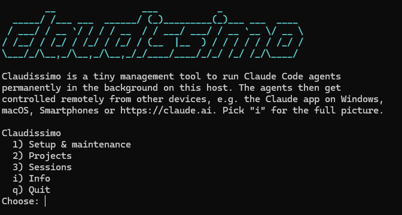

# claudissimo

This tiny tool helps you setup Claude Code background agents and manage
their projects on an Ubuntu/Debian machine to run permanently. You then
remote control them from any other device using the Claude app or website.
This way, you're able to work on code projects on the go while the agents
live on e.g. a VM somewhere and you do not have to leave your laptop on.
Set it up once, and sessions survive reboots on their own.

## Usage

    bin/claudissimo

Shows a numbered menu: Initial setup, Check status, Update, Create new
project, Delete project, Revive dead sessions, Info — all in the same
terminal, no curses UI. Status opens its own submenu so you can look at
projects, background sessions, the boot revive service, the periodic
revive timer, memory, or versions on their own instead of one long dump.

Each action is also available directly as a subcommand — handy for
scripting, e.g. in a cron job:

    bin/claudissimo setup
    bin/claudissimo status [projects|agents|service|timer|memory|versions]
    bin/claudissimo update
    bin/claudissimo new
    bin/claudissimo delete   # still asks you to re-type the project name
    bin/claudissimo revive
    bin/claudissimo info

Projects live under `~/claude-projects` by default; override with
`CLAUDE_PROJECTS_ROOT=/some/other/path bin/claudissimo ...`.

## Functions

This tool offers five actions through a one-line interactive menu — no
curses UI, output stays in your normal scrollback:

1. **Initial setup** — installs the pieces needed to run background sessions
   and survive a reboot: `jq`, `git`, `curl`, Claude Code itself if missing
   (via the official installer), a revive script plus a systemd user
   service, a **systemd timer that re-runs it every 15 minutes** (not just
   at boot — Claude Code's own supervisor can stop an idle or
   memory-pressured session mid-uptime; see
   [agent-view.md](https://code.claude.com/docs/en/agent-view.md)), enables
   linger so these units run without an active login, and turns on
   `remoteControlAtStartup` in `~/.claude/settings.json` so new sessions can
   be controlled remotely from the start. From the interactive menu, it
   explains itself and asks for confirmation before changing anything.
2. **Status** — reports, for every project directory and every background
   session: whether it's actually alive, whether it ended up in an unwanted
   git worktree, whether the revive service and the periodic revive timer
   are enabled, and current memory usage (host total/free plus claude
   processes' RSS — low memory makes Claude Code's own supervisor stop
   idle sessions sooner). Also reports versions: claude's, jq/git/curl's
   (plus whether apt has a pending upgrade for them), whether the three
   deployed files still match this tool's current version, and whether
   this checkout itself is behind its git remote (if it has one) —
   everything `update` would act on, shown without changing anything.
3. **Update** — refreshes what this host needs to keep running: `claude
   update`, the `jq`/`git`/`curl` packages, this tool's own repo
   (`git pull --ff-only`, if it's a checkout with an upstream and no
   uncommitted changes), and the three deployed files (revive script,
   systemd service, systemd timer) if this tool's version of them has
   changed — including whatever the repo pull just brought in. Never
   overwrites a deployed file without asking first. Does **not** touch
   your *managed project* repos (trace, ngtrng, ...) — those stay plain
   `git pull`, by hand, per project.
4. **New project** — asks for a project name, then whether it should be a
   git project or purely local: git clones a remote if you give one (or
   just runs `git init`), local skips `.git` entirely. Sets
   `bgIsolation: none` so background sessions edit the project folder
   directly instead of a worktree copy. Runs `claude` interactively once
   for the first-run trust confirmation (that's on you), then starts the
   first background session, named after the project, with a fixed
   prompt that has it report its hostname, working directory, and git
   remote.
5. **Delete project** — completely removes a project: stops and removes
   any background session still pointing at it, deletes the project
   directory under `~/claude-projects`, and deletes its Claude Code
   metadata under `~/.claude/projects/` (session history, memory). Warns
   about uncommitted changes and commits not pushed to any upstream
   before you confirm — those would be lost; nothing else needs doing on
   the GitHub side, deleting a local clone doesn't touch the remote repo.
   Asks you to re-type the project name to confirm — this cannot be
   undone.
6. **Revive dead sessions** — runs the deployed revive script right now,
   instead of waiting for a reboot: for when a session died mid-uptime
   (a crash, say) rather than from the VM restarting. Same logic the
   systemd service uses at boot — checks every session's pid, and
   `claude respawn`s whichever ones aren't actually alive.

## Troubleshooting

Background sessions should show up automatically in the Claude app (or
claude.ai) on any other device signed into the same account — no extra step
needed. If one doesn't show up:

- check it's actually running here first: `bin/claudissimo status` (a dead
  session can't show up anywhere)
- make sure this machine has internet access (setup needs it to register
  sessions with claude.ai)
- make sure you're signed into the same Claude account on both this machine
  and the other device
- a session started before `remoteControlAtStartup` was enabled may not
  have picked it up — try `claude respawn <id>` on it, or just create a new
  one (unverified, worth testing)
- if it's alive here but shows as unreachable in the app, restart the
  Claude app on the other device completely

## Why `pid`, not `pgrep`

A dead background session can still show state `done` after a reboot, and
`claude respawn` hands a session to a pre-started spare process whose command
line doesn't contain the session id — so matching by name with `pgrep` gives
false positives. The only reliable check is reading the `pid` from
`claude agents --json --all` and confirming `/proc/<pid>/cmdline` still
belongs to a `claude` process. Both the revive script and the status action
use this check.

## Requirements

- Tested on **Ubuntu/Debian**. `setup` installs missing packages via
  `apt-get` — that's the one Debian-specific step. Everything else (systemd
  user services, `loginctl` linger, bash, jq, git, curl, claude) works on any
  systemd-based Linux; on other distros, install `jq`/`git`/`curl` yourself
  before running `setup`.

## Status of this tool

This whole tool builds on Claude Code's "Agent view" (background sessions,
`claude --bg`, Remote Control) — a research preview from Anthropic, not a
finished, generally released feature, as of 2026-10-25 on Claude Code
2.1.310. It can change behavior or break between Claude Code versions
with no notice from this tool.
